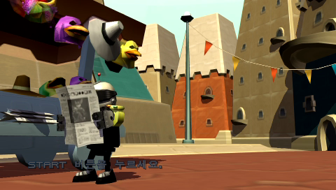
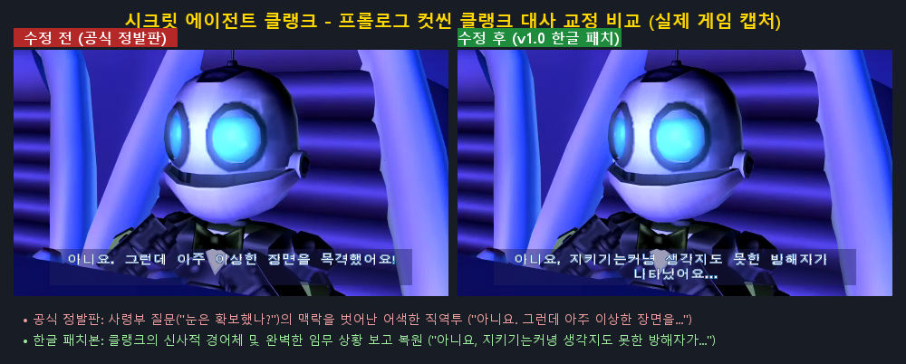
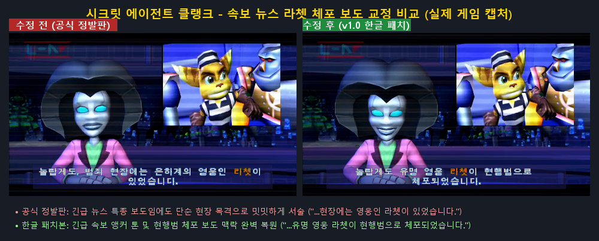
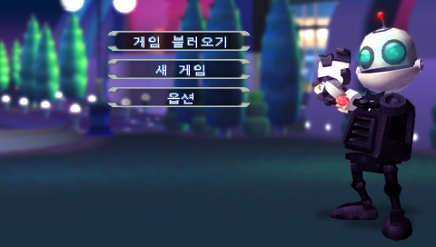
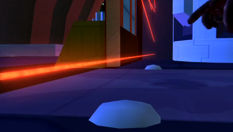

# 시크릿 에이전트 클랭크 — PSP

PSP **시크릿 에이전트 클랭크 (Secret Agent Clank™)** 일본판(`UCJS10084`) 대조 정식 한국판(`UCKS45096`) 번역 업데이트 프로젝트입니다.

> **현재 상태: 번역 및 대사 교정 135건 반영 완료 · 실기/플레이 검증 진행 중 (Pre-release)**
> *(아직 전체 플레이 테스트가 완료되지 않았으므로 정식 배포 릴리즈 파일은 등록되지 않았습니다.)*

<!-- game-preview:start -->
<p align="center">
  
</p>

**타이틀 화면** — PPSSPP 에뮬레이터에서 패치된 `Secret Agent Clank [K] (Updated).iso`로 직접 부팅하여 캡처한 화면입니다.
<!-- game-preview:end -->

---

## 프로젝트 개요

2008년 소니(SCEK)를 통해 정식 발매된 PSP용 《시크릿 에이전트 클랭크》(UCKS45096)는 완성도 높은 액션 어드벤처였으나, 현지화 과정에서 발생한 여러 기술적 결함과 어색한 번역들이 존재했습니다:

1. **빌드 도구 자동 강조 오류**: 키워드 자동 하이라이터 버그로 인해 복합 명사 내부가 쪼개지며 노란색으로 강조되던 현상 (35건)
   - 예: `축<COL:02>전기<COL:01>`, `주파<COL:02>수로<COL:01>`, `<COL:02>프로토<COL:01>타입`, `<COL:02>전자<COL:01>기 자물쇠`, `<COL:02>전화<COL:01>박스`
2. **치명적 결함 및 미번역 잔재**: 깨진 버튼 매크로(`_[circlebutton]`), 미번역 영문(`"CREDITS"`, 메모리스틱 저장 경고문), 일본어 더미 바이트 잔재 (8건)
3. **스킬포인트 및 시스템 오역**: 
   - `KO ID 4143`: `"나비 춤을 추세요"` $\rightarrow$ **`"나비 5마리를 밟으세요"`** (원문 `ふみつぶす` 오역)
   - `KO ID 4145`: `"15만 박스"` $\rightarrow$ **`"150,000 이상 획득하세요"`** (`bucks` 오역)
   - `KO ID 4161`: `"론머"` $\rightarrow$ **`"잔디깎이"`** (단순 음차)
   - `KO ID 2175`: `"보이지 않는 포탑"` $\rightarrow$ **`"파괴할 수 없는 포탑"`** (Invulnerable 오역)
4. **스토리 컷씬 대사 왜곡 및 뉘앙스 정밀 교정 (54건)**:
   - **반대 오역 수정**: `넘버 우`가 클랭크에게 전기를 쏘며 취약하다고 비웃는 장면이 정반대(`"효과가 없는 모양이야"`)로 번역된 것을 원문대로 바로잡음.
   - **클렁크 변장 간파 오역 수정**: 클렁크가 자신의 킹핀 변장을 간파한 클랭크를 칭찬하는 대사 복원.
   - **유머 및 티키타카 복원**: 포춘 쿠키 조크, 쿼크 자서전 허세 만담, 클랭크의 시니컬한 츳코미(`"전혀 간단하지 않잖아요."`), 클렁크 청소기 결말 복원.
   - **캐릭터 어조 통일**: 클랭크(정중한 로봇 경어체), 라쳇(자신만만한 말투), 클렁크(교활한 악당체) 정립.
5. **인게임 도감 및 팝업 교정 (18건)**: 온실가스, 록 기타 속주, 클립온 넥타이, 각종 맞춤법 및 오타 수정.

---

## 공식 정발판 결함 vs v1.0 패치 비교

<p align="center">
  
</p>

<p align="center">
  
</p>

---

## 지원 원본 및 타깃 해시

| 항목 | 디스크 ID / 파일명 | 크기 (bytes) | SHA-256 |
|---|---|---:|---|
| **지원 원본 (KO)** | `UCKS45096` / `Secret Agent Clank [K].iso` | 1,222,705,152 | `f0d5a191bdbf2fc05b403b065cbbb867a8974dd89686b3deb8a0d69601391007` |
| **대조 원본 (JA)** | `UCJS10084` / `Clank & Ratchet (Japan).iso` | 1,115,258,880 | `6ebeaa0021e40b9b150725deb18caeedca7d42b9c0330287ff18e9981c7ea647` |
| **패치 결과 (Updated)** | `Secret Agent Clank [K] (Updated).iso` | 1,222,705,152 | `ccad6a0f2c7baaf90548736c64b498f585570733ca7708fa815e4b3cca2cbb7e` |

> [!IMPORTANT]
> 본 저장소는 저작권 보호를 위해 원본 ISO 또는 수정된 ISO 바이너리를 일절 제공하지 않습니다.

---

## 런타임 검증 화면

PPSSPP 에뮬레이터(`emucap-control`) 환경에서 패치된 ISO를 구동하여 렌더링을 확인했습니다:

<p align="center">
  
  
</p>

- 타이틀 및 메인 메뉴 정상 동작 (`게임 불러오기`, `새 게임`, `옵션`)
- 메모리스틱 세이브/로드 시스템 연동 정상 동작
- 프롤로그 볼테어 박물관 잠입 실시간 3D 컷씬 정상 동작

---

## 소스 재빌드 안내 (Build from source)

Python 3.10+ 환경에서 다음 명령어로 패치 바이너리 및 업데이트 ISO를 100% 동일한 비트 단위로 재현할 수 있습니다:

```powershell
# 1. 패치 바이너리 생성 및 검증 (LOCALDAT_K.BIN, HELPLOCALDAT_K.BIN)
python -B scripts/build_patched_localdat.py

# 2. 업데이트 ISO 생성 (dist/ 폴더에 생성)
python -B scripts/build_iso.py

# 3. 프로젝트 정적 무결성 감사
python -B scripts/audit_session.py
```

---

## 크레딧과 문의

- **한글 패치 및 역공학**: [AKUMA815](https://github.com/akuma815)
- **원작 저작권**: © 2008 Sony Interactive Entertainment America Inc. Developed by High Impact Games.
- **[버그 신고 및 문의](https://github.com/akuma815/psp-secret-agent-clank-kr-patch/issues)**
- **[한글 패치 아카이브](https://akuma815.github.io/)**
